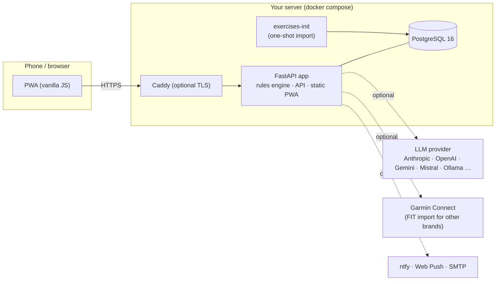

# COACH

**A self-hosted, privacy-first sports coach.** It builds multisport training plans (running, trail, cycling, strength, hybrid/Hyrox-style) from a *deterministic, evidence-cited rules engine*, suggests nutrition targets, syncs your watch, and — optionally — adds an LLM "coach" that comments on your week but is never allowed to invent numbers.

> ⚠️ **Not a medical device and not dietary advice.** COACH gives general training and nutrition suggestions. It does not replace a doctor, physiotherapist or dietitian. Stop and consult a professional on pain, dizziness, chest symptoms or any red flag. See [DISCLAIMER](DISCLAIMER.md).

> 🌍 The UI, the questionnaire and the LLM prompts are currently **in French**. Translating them is an open, well-scoped task — see the [issue board](https://github.com/ECG-Rudy-Glt/COACH/issues) and `skills/add-language/`. The code, docs and APIs are in English.

## Why this exists

| Goal | How |
|---|---|
| **Trustworthy numbers** | Volumes, intensities and nutrition targets come from a rule engine (`app/plan`, `app/nutrition`), not from a language model. Same facts in → same plan out. |
| **Every rule is sourced** | Each session cites rule IDs ([docs/rules.md](docs/rules.md)); rules link to 60 publications (`data/evidence/*.yaml`: abstract-level summaries with their limits and a confidence level; a full human review of the evidence base is still open). |
| **LLM on a leash** | The LLM explains and proposes at most a few *bounded* adjustments; the server validates every proposal against the rules and drops what it cannot justify. Works fine **without** an LLM. |
| **Your data stays yours** | Self-hosted, one Postgres, no telemetry. Health data is sent to an LLM only if you configure one — and a local model (Ollama) keeps even that on your machine. |
| **Any wearable, any model** | Garmin built in; other brands through a small adapter or FIT-file import. Anthropic, OpenAI, Gemini, Mistral, OpenRouter, Ollama or any OpenAI-compatible server. |
| **Phone-first** | Installable PWA for iPhone and Android, offline shell, web-push / ntfy / e-mail reminders. |

## Features

- Adaptive questionnaire (~100 questions across 13 domains) that only asks what the next decision needs
- Weekly plan generation with training cycles (3 build weeks + 1 deload), phases toward a target event, injury/pain handling
- Strength sessions with a 1 700+ exercise library (wger + free-exercise-db, per-media author and license shown)
- Nutrition: calorie/protein targets, weight-trend feedback, meal logging with optional photo → LLM estimate
- Garmin Connect sync (activities + resting HR, VO2max, race predictions, training load) and automatic matching with planned sessions
- LLM coach: weekly review, chat with read-only history tools, notifications — with a hard monthly budget cap
- Multi-user accounts (scrypt passwords, HttpOnly sessions, per-user data isolation)

## Architecture at a glance



More diagrams (data flow, plan pipeline, LLM safety boundary, data model): [docs/architecture.md](docs/architecture.md).

## Quick start (5 minutes, Docker)

Requirements: Docker with the Compose plugin, ~1 GB RAM, Internet access for the first start (exercise library import).

```sh
git clone https://github.com/ECG-Rudy-Glt/COACH.git && cd COACH
scripts/init-secrets.sh          # creates ./secrets/* and .env (random DB password + encryption key)
docker compose up -d --build     # db → app → one-shot exercise import
open http://127.0.0.1:8000       # the first account you create is the owner; registration then closes
```

Prefer a ready-made image over building? Set `COACH_IMAGE=ghcr.io/ecg-rudy-glt/coach:0.1.0` in `.env` and run `docker compose pull && docker compose up -d` (images are published for every `vX.Y.Z` tag, `linux/amd64` and `linux/arm64`).

Add an AI coach (optional): put your key in `secrets/llm_api_key`, set `LLM_PROVIDER` in `.env`, then `docker compose up -d`. No key → the app runs fully, minus the coach, chat and meal-photo estimate.

Next steps:

| I want to… | Read |
|---|---|
| Configure providers, models, budget, notifications | [docs/configuration.md](docs/configuration.md) |
| Reach it from my phone / the Internet safely (VPN, Cloudflare Tunnel, ngrok, reverse proxy) | [docs/exposure.md](docs/exposure.md) |
| Install it as an app on iPhone / Samsung / Android | [docs/pwa.md](docs/pwa.md) |
| Understand the security model and harden my install | [docs/security.md](docs/security.md) |
| Connect Garmin, import Coros/FIT files, add a new source or service | [docs/integrations.md](docs/integrations.md) |
| Know what to put in (and keep out of) LLM prompts | [docs/prompts.md](docs/prompts.md) |
| Fork and extend it with an AI coding assistant | [AGENTS.md](AGENTS.md) and [skills/](skills/) |
| Contribute | [CONTRIBUTING.md](CONTRIBUTING.md) |

## Develop locally

```sh
python3 -m venv .venv && .venv/bin/pip install -r requirements-dev.txt
.venv/bin/ruff check . && .venv/bin/pytest -q        # no database needed: tests use an in-memory repository
.venv/bin/uvicorn app.main:app --reload              # in-memory storage when no database is configured
```

Postgres-backed tests run when `TEST_DATABASE_URL` is set (they are skipped otherwise; CI runs them).

## Status

Early but in daily use by its author. The rules engine, plan, nutrition, Garmin sync and coach are implemented and tested; see the [issue board](https://github.com/ECG-Rudy-Glt/COACH/issues) for what is next (more wearables, English UI, evidence review).

## License

[AGPL-3.0-only](LICENSE) — if you run a modified version as a network service, you must offer its source to its users. Third-party data and libraries: [THIRD_PARTY.md](THIRD_PARTY.md).
