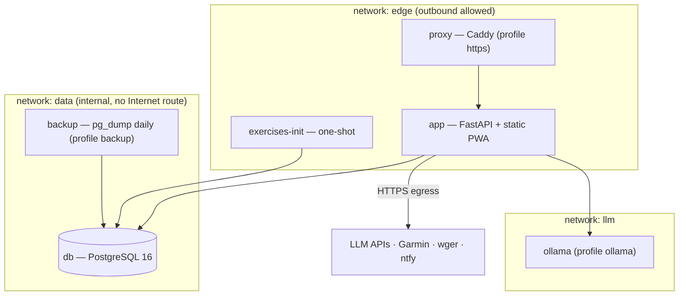
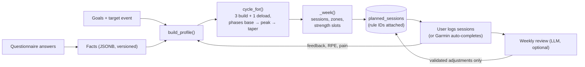
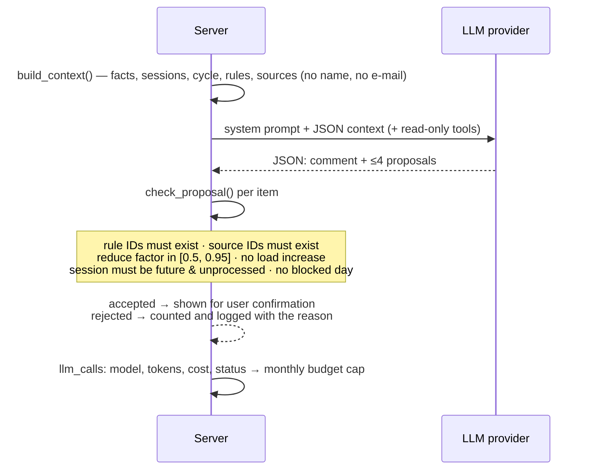
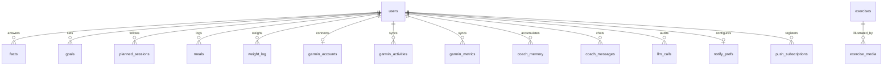

# Architecture

COACH is one FastAPI process, one PostgreSQL database and a static vanilla-JS PWA served by the same process. There is no message bus, no worker fleet and no build step for the front end.

## Design principles

1. **Deterministic core.** Plans, volumes, intensities and nutrition targets are pure functions of the user's *facts* and *goals*. Same input → same output, testable without a model.
2. **Every rule has an ID and a test.** Sessions carry the rule IDs they applied ([rules.md](rules.md)); `tests/` asserts the rule digest matches the document.
3. **The LLM is an explainer, not a calculator.** It receives a compact, server-built snapshot, may call read-only tools, and may only *propose* a short list of bounded adjustments that the server validates (`check_proposal`).
4. **Optional everything.** No LLM key, no Garmin, no notification channel — the app still plans and tracks.
5. **Small blast radius.** Per-user data isolation on every route, secrets as files, internal Docker network for the database.

## Runtime topology

* `db` and `backup` sit on an **internal** network: they cannot reach, or be reached from, the Internet.
* `app` joins `data` (database), `edge` (egress to LLM/Garmin/wger) and `llm` (local model). Only `app` (or `proxy`) publishes a port, bound to `127.0.0.1` by default.
* Secrets are mounted as files under `/run/secrets` and read through the `NAME_FILE` convention (`app/config.py:env`).

## Module map

| Path | Responsibility |
|---|---|
| `app/main.py` | App assembly, security middleware (CSP & headers, same-origin writes), routers, background threads |
| `app/auth.py` | Accounts, scrypt hashing, sessions, login throttling, registration modes |
| `app/questionnaire/` | Question bank (`questions/*.yaml`), conditional engine, answers → timestamped *facts* |
| `app/goals.py`, `app/benchmarks.py` | Goals and performance benchmarks (derived facts) |
| `app/plan/` | **Plan engine**: profile building, cycles/phases, weekly sessions, strength templates, pain handling, long-horizon trajectory (`trajectory.py`) |
| `app/nutrition/` | **Nutrition engine** (BMR, targets, weight trend, advice) + LLM meal analysis (`analyze.py`) |
| `app/exercises/` | Exercise library API, importer (wger + free-exercise-db + `data/custom_exercises.yaml`), media proxy |
| `app/evidence.py` | Loads `data/evidence/*.yaml`, validates rule links, builds the citable digest |
| `app/garmin/` | Garmin adapter (`client.py`), sync (`api.py`, `scheduler.py`), session matching (`match.py`), token encryption (`crypto.py`) |
| `app/coach/` | LLM coach: provider layer (`llm.py`), weekly review (`service.py`), onboarding analysis (`intake.py`), chat (`chat.py`), history tools (`history.py`), notifications (`notify.py`) |
| `app/activity_import/` | FIT/TCX/GPX file import: pure parsers (`parse.py`) and upload route (`api.py`) |
| `app/repo/` | storage: `protocol.py` (`Repo`), one module per domain (`accounts`, `exercises`, `goals`, `plan`, `garmin`, `coach`, `chat`, `nutrition`) holding its in-memory and Postgres halves, assembled by `memory.py` (`MemoryRepo`: tests, demo) and `postgres.py` (`PostgresRepo`: production) |
| `app/static/` | PWA: `app.js`, `style.css`, `sw.js` (service worker), `manifest.webmanifest` |
| `db/migrations/` | Forward-only SQL migrations applied at start-up |
| `data/` | Rules digest, evidence base, custom exercises, LLM provider catalog |

## Plan generation pipeline

Only **one week** is generated at a time, after reading the previous week's feedback, so the plan adapts instead of drifting.

## LLM safety boundary

The model can never write to the database, add load, invent a rule or a citation, or see identity data.

## Data model (summary)

`facts.value` is JSONB so long, nested history (career, benchmarks) needs no extra store; Postgres keeps transactions and a single backup target. See [llm-memory.md](llm-memory.md) for why there is no separate vector/NoSQL store.

## Request lifecycle

Browser → (optional proxy) → `security_headers` middleware → `same_origin_writes` → router → `current_user` (cookie → session hash lookup) → `require_user` (path `user_id` must equal the session user) → repo. Background threads (Garmin sync, notifications) start in the `startup` hook and are no-ops unless `AUTO_SYNC=1` / `AUTO_NOTIFY=1`.
