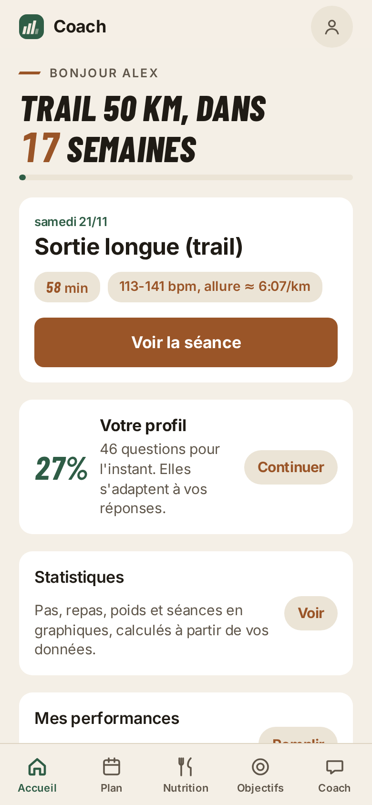
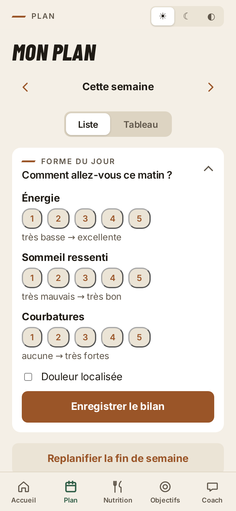

# Application de bureau COACH (Windows et Linux)

Un seul installateur, rien d'autre à installer. L'application de bureau embarque le serveur COACH et une base locale, s'ouvre dans sa propre fenêtre et garde tout sur votre ordinateur. English: [desktop.md](desktop.md).

> Pas un dispositif médical ni un conseil diététique, comme le reste de COACH : voir [DISCLAIMER.md](../DISCLAIMER.md).

## Ce que vous obtenez (et ce que vous n'obtenez pas)

- Une fenêtre de bureau classique. Derrière, un serveur COACH démarre sur `127.0.0.1` uniquement (jamais joignable depuis le réseau, sur un port libre choisi au hasard) et s'arrête quand vous fermez la fenêtre.
- Vos comptes, plans et journaux sont dans un fichier SQLite local. Aucun compte sur un site, aucune télémétrie.
- Le coach IA est **facultatif**. Sans lui, COACH construit quand même votre plan et vos objectifs nutritionnels (ils ne viennent jamais d'une IA de toute façon). Détails dans [le guide de la clé IA](#guide-de-la-clé-ia).
- Non inclus : versions macOS, accès depuis le téléphone, notifications push / e-mail / ntfy (elles demandent un serveur que vous gérez : utilisez l'[installation Docker](../README.md#quick-start-5-minutes-docker)), mises à jour automatiques.

## 1. Télécharger

Ouvrez la [page des Releases](https://github.com/ECG-Rudy-Glt/COACH/releases) et choisissez la version dont l'étiquette commence par `desktop-v`.

| Système | Fichier à télécharger |
|---|---|
| Windows 10/11 | `COACH_<version>_x64-setup.exe` (conseillé) ou `COACH_<version>_x64_fr-FR.msi` |
| Linux (distribution récente) | `COACH_<version>_amd64.AppImage` |
| Debian / Ubuntu | `COACH_<version>_amd64.deb` |

Téléchargez aussi `SHA256SUMS.txt` depuis la même release.

## 2. Vérifier le téléchargement (SHA-256)

Les installateurs sont construits par GitHub Actions à partir de ce dépôt. `SHA256SUMS.txt` permet de vérifier que votre fichier est bien celui qui a été construit, ni corrompu ni remplacé.

```sh
# Linux (dans le dossier de téléchargement)
sha256sum -c SHA256SUMS.txt --ignore-missing
```

```powershell
# Windows (PowerShell) : la valeur doit être identique à la ligne de SHA256SUMS.txt
Get-FileHash .\COACH_0.1.0_x64-setup.exe -Algorithm SHA256
```

Si les valeurs diffèrent, ne lancez pas le fichier et téléchargez-le de nouveau.

## 3. Installer

### Windows et l'avertissement SmartScreen

Les installateurs ne sont **pas signés** (un certificat de signature est payant). Windows SmartScreen affiche donc « Windows a protégé votre PC / éditeur inconnu ». Ce n'est pas une détection de virus. Après avoir vérifié la somme SHA-256 : cliquez sur **Informations complémentaires**, puis **Exécuter quand même**.

Lancez le `-setup.exe` (installation pour votre seul utilisateur, sans droits d'administrateur) ou le `.msi`. Démarrez **COACH** depuis le menu Démarrer.

### Linux

```sh
chmod +x COACH_*.AppImage && ./COACH_*.AppImage     # AppImage (Ubuntu 22.04+ : installez libfuse2 s'il refuse de démarrer)
sudo apt install ./COACH_*_amd64.deb               # Debian / Ubuntu
```

La clé IA est rangée dans le trousseau de votre bureau (GNOME Keyring ou KWallet, présents sur la plupart des bureaux). Sans trousseau, vous pouvez utiliser COACH sans IA ou avec Ollama.

## 4. Premier lancement, pas à pas

1. **Écran d'assistant.** COACH demande quel assistant IA utiliser. Dans le doute, choisissez **Aucun** : vous pourrez changer à tout moment dans **COACH > Réglages**. Cliquez sur **Démarrer COACH**.
2. **Attente.** Le premier démarrage prend quelques secondes (le serveur se lance et crée sa base).
3. **Créez votre compte.** Le premier compte est le propriétaire ; c'est local, rien n'est envoyé. Choisissez un mot de passe d'au moins 10 caractères et conservez-le : il n'y a pas de serveur d'e-mail pour envoyer un lien de réinitialisation. L'inscription se ferme ensuite (personne d'autre ne peut créer de compte via l'application).
4. **Répondez aux questions essentielles** (voir [Ce qu'il reste à remplir](#ce-quil-reste-à-remplir)).



## Guide de la clé IA

### À quoi sert la clé

Le coach IA rédige des explications, répond à vos questions dans le chat, propose de petits ajustements bornés de votre semaine (le serveur les vérifie avec les règles), estime un repas à partir d'une photo et pose les questions manquantes à l'accueil. Il ne produit jamais les chiffres de votre plan ni de vos objectifs nutritionnels.

### Faut-il en avoir une ?

Non. Tout ce qui est marqué « facultatif » fonctionne sans, et COACH indique quand une fonction IA est désactivée. Ajoutez une clé quand vous voulez le chat, le bilan hebdomadaire ou l'estimation d'un repas sur photo.

### Ce qui quitte votre ordinateur

Seulement si vous choisissez un fournisseur dans le cloud : les questions et le contexte de la fonction IA utilisée (vos données et votre entraînement récent, jamais votre nom ni votre e-mail, voir [docs/prompts.md](prompts.md)) partent chez ce fournisseur. Avec **Ollama** (modèle local) ou **Aucun**, rien ne quitte l'ordinateur pour l'IA.

### Où la clé est rangée

Dans le trousseau de votre système (Gestionnaire d'identifiants Windows, GNOME Keyring / KWallet). Jamais dans un fichier de l'application, jamais dans les journaux, jamais réaffichée après l'enregistrement. Le serveur ne la reçoit que sous forme de variable d'environnement, à son démarrage.

### Un abonnement ChatGPT ou Claude n'est pas une clé d'API

Il faut un compte développeur **API** avec facturation chez le fournisseur. Les abonnements des applications de chat ne peuvent pas être utilisés par une application.

### Créer une clé, fournisseur par fournisseur

Les menus changent de temps en temps ; cherchez « API keys », « Billing » et « Limits ». L'assistant a un bouton **Créer une clé chez ce fournisseur** qui ouvre la bonne page dans votre navigateur.

| Fournisseur | Page | Étapes |
|---|---|---|
| **Anthropic (Claude)** | [console.anthropic.com/settings/keys](https://console.anthropic.com/settings/keys) | Connectez-vous, ajoutez du crédit dans Billing, **Create Key**, copiez la clé (affichée une seule fois). Fixez une limite de dépense mensuelle dans Limits. |
| **OpenAI** | [platform.openai.com/api-keys](https://platform.openai.com/api-keys) | Connectez-vous, ajoutez du crédit dans Billing, **Create new secret key**, copiez-la (affichée une seule fois). Fixez un budget mensuel dans Limits. |
| **Google Gemini** | [aistudio.google.com/apikey](https://aistudio.google.com/apikey) | Connectez-vous avec un compte Google, **Create API key**, copiez-la. Un niveau gratuit existe, avec des limites strictes ; en usage payant, activez la facturation du projet Google Cloud lié et ajoutez une alerte de budget (une alerte prévient, elle ne coupe pas toujours la dépense). |
| **Mistral AI** | [console.mistral.ai/api-keys](https://console.mistral.ai/api-keys) | Connectez-vous, activez la facturation, **Create new key**, copiez-la. Fixez une limite de dépense dans les réglages de facturation. |
| **OpenRouter** | [openrouter.ai/keys](https://openrouter.ai/keys) | Connectez-vous, achetez un petit crédit (prépayé : impossible de dépasser), **Create Key** et donnez-lui une limite de crédit. Dans COACH, saisissez un nom de modèle du catalogue OpenRouter si vous ne voulez pas le choix automatique. |
| **Ollama (local)** | [ollama.com/download](https://ollama.com/download) | Pas de clé. Installez Ollama, puis dans un terminal : `ollama pull qwen2.5:7b`. Laissez Ollama lancé. Dans COACH, choisissez **Ollama** ; l'adresse par défaut `http://127.0.0.1:11434/v1` convient s'il tourne sur le même ordinateur. Ce modèle ne lit pas les photos de repas. |

Dans COACH : **COACH > Réglages**, choisissez le fournisseur, collez la clé (le champ est masqué), indiquez au besoin un modèle (vide = celui que COACH recommande), réglez le budget, **Enregistrer et redémarrer**.

### Plafonner la dépense, deux fois

1. **Chez le fournisseur** (le vrai garde-fou) : limite mensuelle ou crédit prépayé, comme dans le tableau.
2. **Dans COACH** : le budget mensuel (par défaut **5 EUR**). Quand l'estimation de COACH l'atteint, les appels IA sont refusés jusqu'au mois suivant ; le reste continue de fonctionner. *Profil > Préférences > Coût de l'IA ce mois-ci* affiche l'estimation (calculée avec les tarifs publics : la facture du fournisseur fait foi).

### Coût typique

Avec les modèles par défaut et une personne qui l'utilise chaque jour, comptez de quelques centimes à environ un euro par mois ; un usage intensif du chat ou beaucoup de photos de repas coûtent plus. C'est un ordre de grandeur, pas une promesse : fiez-vous aux deux plafonds ci-dessus.

### Si l'IA répond « non configurée »

- Ouvrez **COACH > Réglages** et vérifiez qu'un fournisseur autre que **Aucun** est choisi et qu'une clé est enregistrée (« Une clé est déjà enregistrée » s'affiche).
- Collez de nouveau la clé (sans espace ni retour à la ligne) ; une clé d'un autre fournisseur est refusée par celui-ci.
- Vérifiez la facturation / le crédit sur le site du fournisseur, et que le budget mensuel de COACH n'est pas épuisé.
- Ollama : vérifiez qu'il tourne (`ollama list`) et que le nom du modèle correspond.
- Linux : si l'enregistrement de la clé échoue, installez et déverrouillez un trousseau (GNOME Keyring ou KWallet), ou utilisez Ollama / Aucun.

## Ce qu'il reste à remplir

Rien n'est obligatoire hormis votre compte et l'avis de santé. Dans l'ordre :

1. **Compte local** : identifiant de type e-mail et mot de passe (gardés sur cet ordinateur uniquement).
2. **Questions essentielles** (13 écrans au plus) : sports, objectifs, âge, sexe, taille, poids, avis de santé et signaux d'alerte, jours d'entraînement, durée des séances, blessures, volume de course et niveau en force. Pourquoi : le moteur de règles en a besoin pour dimensionner un plan en sécurité. Vous pouvez tout passer sauf l'avis de santé ; une réponse passée rend le plan plus prudent ou plus générique.
3. **Questions de suivi du coach** (avec une IA seulement) : quelques questions manquantes au plus, chacune avec sa raison. Sans IA, COACH pose lui-même celles qui restent obligatoires.
4. **Objectifs** : une échéance datée ou un objectif général. Un objectif daté donne ses phases au plan.
5. **Générer le plan** : depuis l'accueil. Le premier plan sort des règles, avec les identifiants de règles cités sur chaque séance.
6. **Nutrition et poids** : saisissez votre poids régulièrement et, si vous le souhaitez, vos repas (code-barres et texte ; l'estimation sur photo demande une IA capable de lire les images). Les objectifs et le suivi de la tendance de poids sont calculés par des règles.
7. **Montre Garmin (facultatif)** : Profil, puis Garmin. Saisissez une fois vos identifiants Garmin Connect : seuls des jetons chiffrés sont conservés (la clé de chiffrement est dans votre trousseau). Pour une autre marque, importez des fichiers FIT/TCX/GPX ([docs/activity-import.md](activity-import.md)). La bibliothèque Garmin n'est pas officielle, à vos risques.
8. **Langue et thème** : dans le Profil (langue de l'application, du coach et des e-mails ; thèmes clair, sombre et éco).
9. **Notifications** : les rappels par push, ntfy ou e-mail ne sont pas disponibles dans l'application de bureau (ils demandent un serveur configuré par variables d'environnement). Les écrans de l'application restent utilisables.



## Où sont vos données

| Quoi | Windows | Linux |
|---|---|---|
| Dossier de données | `%APPDATA%\io.github.ecgrudyglt.coach` | `~/.local/share/io.github.ecgrudyglt.coach` |

Dedans : `coach.db` (tout : comptes, plans, journaux), `media/` (photos, images d'exercices en cache), `settings.json` (fournisseur, modèle, budget : pas de clé), `logs/sidecar.log` (journal du serveur, remplacé à chaque démarrage). Ouvrez-le depuis **COACH > Ouvrir le dossier de données**. La clé IA et la clé de chiffrement Garmin sont dans le trousseau de l'OS (service `COACH`).

## Sauvegarder et restaurer

- **Sauvegarder** : **COACH > Sauvegarder mes données…**, choisissez où enregistrer une copie de `coach.db`. C'est une copie cohérente faite avec la fonction de sauvegarde de SQLite, sûre pendant que COACH tourne. Gardez-la aussi ailleurs que sur cet ordinateur. Votre clé IA n'y est pas (ni dans aucun fichier) : vous la ressaisissez après une réinstallation.
- **Restaurer** : fermez COACH, mettez de côté le `coach.db` actuel, copiez votre sauvegarde dans le dossier de données sous le nom `coach.db`, relancez COACH. Sur un autre ordinateur, les jetons Garmin ne se déchiffreront pas (la clé reste dans l'ancien trousseau) : reconnectez Garmin.

## Mettre à jour

Téléchargez le nouvel installateur, vérifiez sa somme SHA-256 et installez-le par-dessus l'ancienne version (fermez COACH avant). Vos données et réglages restent ; les migrations de base s'exécutent au démarrage suivant. Faites d'abord une sauvegarde. Il n'y a pas de mise à jour automatique.

## Désinstaller

- Windows : *Paramètres > Applications > COACH > Désinstaller*.
- Linux : supprimez l'AppImage, ou `sudo apt remove coach`.

Le dossier de données n'est **pas** supprimé (une réinstallation retrouve tout). Pour tout effacer : supprimez le dossier de données et retirez les entrées `COACH` du trousseau (Windows : Gestionnaire d'identifiants, Informations d'identification Windows ; Linux : « Mots de passe et clés » ou KWalletManager).

## Dépannage

| Symptôme | Que faire |
|---|---|
| « COACH n'a pas pu démarrer » | Lisez `logs/sidecar.log` dans le dossier de données ; cliquez sur **Réessayer**. Un antivirus peut bloquer le premier démarrage du serveur embarqué : autorisez COACH. |
| Premier démarrage très lent | Normal pendant quelques secondes (le serveur se décompresse). Plus d'une minute : voyez le journal. |
| Rien ne s'ouvre, fenêtre blanche | Fermez-la depuis la zone de notification / le gestionnaire de tâches ; relancez. Une seule instance de COACH peut tourner. |
| Linux : l'AppImage ne démarre pas | Installez `libfuse2`, ou utilisez le `.deb`. |
| Linux : la clé ne s'enregistre pas | Installez et déverrouillez GNOME Keyring ou KWallet, ou choisissez Ollama / Aucun. |
| Windows : « Windows a protégé votre PC » | Voir [SmartScreen](#windows-et-lavertissement-smartscreen). |
| Clé IA oubliée | Elle ne peut pas être relue, par conception : créez-en une nouvelle chez le fournisseur et collez-la dans les Réglages. |

Bogues et questions : [issues](https://github.com/ECG-Rudy-Glt/COACH/issues). N'y collez jamais vos clés, votre base ni des données de santé. Pour construire les installateurs vous-même, voir [desktop/README.md](../desktop/README.md).
