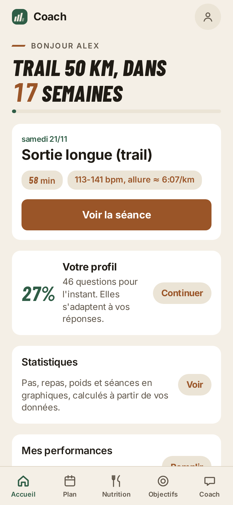
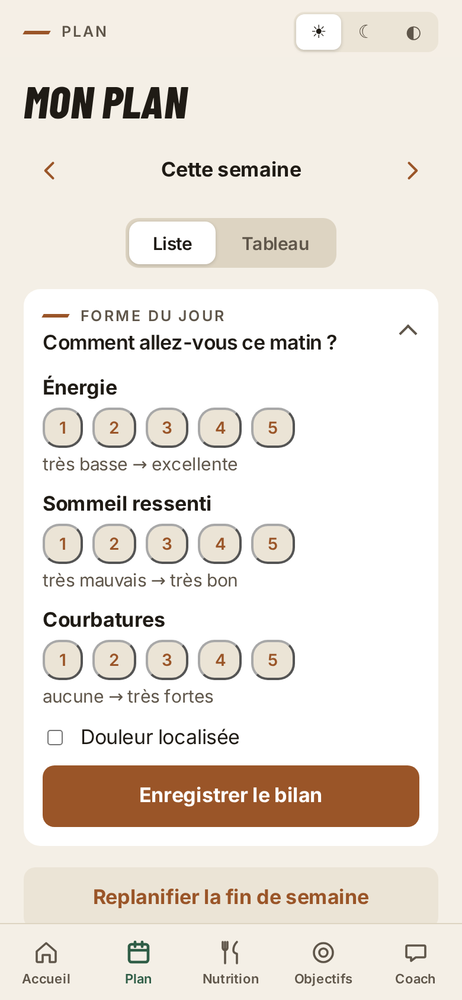

# COACH desktop app (Windows and Linux)

One installer, nothing else to install. The desktop app bundles the COACH server and a local database, opens in its own window and keeps everything on your computer. Français : [desktop.fr.md](desktop.fr.md).

> Not a medical device and not dietary advice, same as the rest of COACH: see [DISCLAIMER.md](../DISCLAIMER.md).

## What you get (and what you do not)

- A normal desktop window. Behind it, a COACH server starts on `127.0.0.1` only (never reachable from the network, on a random free port) and stops when you close the window.
- Your accounts, plans and logs are stored in a local SQLite file. No account on any website, no telemetry.
- The AI coach is **optional**. Without it COACH still builds your plan and your nutrition targets (they never come from an AI anyway). Details in [the AI key guide](#ai-key-guide).
- Not included: macOS builds, phone access, push/e-mail/ntfy notifications (those need a server you run yourself: use the [Docker setup](../README.md#quick-start-5-minutes-docker) for that), automatic updates.

## 1. Download

Open the [Releases page](https://github.com/ECG-Rudy-Glt/COACH/releases) and pick the release whose tag starts with `desktop-v`.

| System | File to download |
|---|---|
| Windows 10/11 | `COACH_<version>_x64-setup.exe` (recommended) or `COACH_<version>_x64_en-US.msi` |
| Linux (any recent distribution) | `COACH_<version>_amd64.AppImage` |
| Debian / Ubuntu | `COACH_<version>_amd64.deb` |

Also download `SHA256SUMS.txt` from the same release.

## 2. Check the download (SHA-256)

The installers are built by GitHub Actions from this repository. `SHA256SUMS.txt` lets you check that your file is the one that was built and was not corrupted or swapped.

```sh
# Linux (in the download folder)
sha256sum -c SHA256SUMS.txt --ignore-missing
```

```powershell
# Windows (PowerShell): the value must be identical to the line in SHA256SUMS.txt
Get-FileHash .\COACH_0.1.0_x64-setup.exe -Algorithm SHA256
```

If the values differ, do not run the file; download it again.

## 3. Install

### Windows and the SmartScreen warning

The installers are **not code-signed** (a certificate costs money). Windows SmartScreen therefore shows "Windows protected your PC / Unknown publisher". It is not a virus detection. After checking the SHA-256 above: click **More info**, then **Run anyway**.

Run the `-setup.exe` (installs for your user only, no administrator rights) or the `.msi`. Start **COACH** from the Start menu.

### Linux

```sh
chmod +x COACH_*.AppImage && ./COACH_*.AppImage     # AppImage (on Ubuntu 22.04+ install libfuse2 first if it refuses to start)
sudo apt install ./COACH_*_amd64.deb               # Debian / Ubuntu
```

The AI key is kept in your desktop's keyring (GNOME Keyring or KWallet, present on most desktops). Without a keyring you can still use COACH without an AI or with Ollama.

## 4. First launch, step by step

1. **Wizard screen.** COACH asks which AI assistant to use. If you are unsure, choose **None** now: you can change it any time in **COACH > Settings**. Click **Start COACH**.
2. **Waiting.** The first start takes a few seconds (the server starts and creates its database).
3. **Create your account.** The first account is the owner; this is local, nothing is sent anywhere. Pick a password of at least 10 characters and keep it: there is no e-mail server to send a reset link. Registration then closes (nobody else can create an account on your computer through the app).
4. **Answer the essential questions** (see [What is left to fill in](#what-is-left-to-fill-in)).



## AI key guide

### What the key is for

The AI coach writes explanations, answers your chat questions, proposes small bounded adjustments to your week (the server checks them against the rules), estimates a meal from a photo and asks the missing questions during onboarding. It never produces the numbers of your plan or your nutrition targets.

### Do I need one?

No. Everything marked "optional" above works without it, and COACH tells you when an AI feature is off. Add a key whenever you want the chat, the weekly review or the meal-photo estimate.

### What leaves your computer

Only if you choose a cloud provider: the questions and context of the AI feature you use (your facts and recent training, never your name or e-mail, see [docs/prompts.md](prompts.md)) go to that provider. With **Ollama** (local model) or **None**, nothing leaves the computer for the AI.

### Where the key is stored

In your operating system's keyring (Windows Credential Manager, GNOME Keyring / KWallet). Never in a file of the app, never in the logs, never shown again after you save it. The server receives it only as an environment variable when it starts.

### A ChatGPT or Claude subscription is not an API key

You need a developer **API** account with billing for the provider. The consumer chat subscriptions cannot be used by an application.

### Create a key, provider by provider

Menus change from time to time; look for "API keys", "Billing" and "Limits". The wizard has a **Create a key with this provider** button that opens the right page in your browser.

| Provider | Page | Steps |
|---|---|---|
| **Anthropic (Claude)** | [console.anthropic.com/settings/keys](https://console.anthropic.com/settings/keys) | Sign in, add credit under Billing, **Create Key**, copy it (shown once). Set a monthly spend limit under Limits. |
| **OpenAI** | [platform.openai.com/api-keys](https://platform.openai.com/api-keys) | Sign in, add credit under Billing, **Create new secret key**, copy it (shown once). Set a monthly budget under Limits. |
| **Google Gemini** | [aistudio.google.com/apikey](https://aistudio.google.com/apikey) | Sign in with a Google account, **Create API key**, copy it. A free tier exists with strict limits; for paid use, enable billing in the linked Google Cloud project and add a budget alert (Google budgets alert, they do not always stop spending). |
| **Mistral AI** | [console.mistral.ai/api-keys](https://console.mistral.ai/api-keys) | Sign in, enable billing, **Create new key**, copy it. Set a spending limit in the billing settings. |
| **OpenRouter** | [openrouter.ai/keys](https://openrouter.ai/keys) | Sign in, buy a small amount of credit (prepaid: you cannot overspend), **Create Key** and give it a credit limit. In COACH, enter a model name (for example from the OpenRouter catalogue) if you do not want the automatic choice. |
| **Ollama (local)** | [ollama.com/download](https://ollama.com/download) | No key. Install Ollama, then in a terminal: `ollama pull qwen2.5:7b`. Keep Ollama running. In COACH choose **Ollama**; the default address `http://127.0.0.1:11434/v1` is right when it runs on the same computer. This model cannot read meal photos. |

In COACH: **COACH > Settings**, pick the provider, paste the key (the field is masked), optionally set a model (empty = the one COACH recommends), set the budget, **Save and restart**.

### Cap your spending, twice

1. **At the provider** (the real safety net): set a monthly limit or use prepaid credit, as in the table.
2. **In COACH**: the monthly budget (default **5 EUR**). Once COACH's own estimate reaches it, AI calls are refused until next month; everything else keeps working. *Profile > Preferences > AI cost this month* shows the estimate (computed from public prices: your provider's invoice is the reference).

### Typical cost

With the default models and one person using it daily, expect from a few cents to roughly a euro per month; heavy chat use or many meal photos cost more. This is an order of magnitude, not a promise: rely on the two caps above.

### If the AI says "not configured"

- Open **COACH > Settings** and check a provider other than **None** is selected and a key is stored ("A key is already stored" is shown).
- Paste the key again (no spaces or line breaks); a key from the wrong provider is refused by that provider.
- Check billing/credit on the provider's site, and that your COACH monthly budget is not used up.
- Ollama: check it is running (`ollama list`) and the model name matches.
- Linux: if saving the key fails, install and unlock a keyring (GNOME Keyring or KWallet), or use Ollama / None.

## What is left to fill in

Nothing is mandatory except your account and the health notice. In order:

1. **Local account**: e-mail-style identifier and password (kept on this computer only).
2. **Essential questions** (about 13 screens at most): sports, goals, age, sex, height, weight, health notice and red flags, training days, session length, injuries, running volume and strength level. Why: the rule engine needs them to size a plan safely. You can skip all but the health notice; skipped answers make the plan more cautious or generic.
3. **The coach's follow-up questions** (only with an AI): it asks at most a few missing questions with the reason for each. Without an AI, COACH asks the remaining required ones itself.
4. **Goals**: a target event with a date, or a general objective. A dated goal gives the plan its phases.
5. **Generate the plan**: from the home screen. The first plan comes out of the rules, with the rule ids cited on each session.
6. **Nutrition and weight**: enter your weight regularly and, if you want, log meals (barcode and text; photo estimate needs an AI with vision). Targets and weight-trend feedback are computed by rules.
7. **Garmin watch (optional)**: Profile, then Garmin. Enter your Garmin Connect credentials once: only encrypted tokens are kept (the encryption key lives in your keyring). For another brand, import FIT/TCX/GPX files ([docs/activity-import.md](activity-import.md)). The Garmin library is unofficial, use is at your own risk.
8. **Language and theme**: in the Profile (language of the app, of the coach and of the e-mails; light, dark and eco themes).
9. **Notifications**: reminders by push, ntfy or e-mail are not available in the desktop app (they need a server configured by environment variables). The in-app screens keep working.



## Where your data lives

| What | Windows | Linux |
|---|---|---|
| Data folder | `%APPDATA%\io.github.ecgrudyglt.coach` | `~/.local/share/io.github.ecgrudyglt.coach` |

Inside: `coach.db` (everything: accounts, plans, logs), `media/` (photos, cached exercise images), `settings.json` (provider, model, budget: no key), `logs/sidecar.log` (server log, replaced at each start). Open it from **COACH > Open data folder**. The AI key and the Garmin encryption key are in the OS keyring (service `COACH`).

## Back up and restore

- **Back up**: **COACH > Back up my data...**, choose where to save a copy of `coach.db`. It is a consistent copy made with SQLite's backup function, safe while COACH runs. Keep it somewhere other than this computer too. Your AI key is not in it (nor in any file): you re-enter it after a reinstall.
- **Restore**: close COACH, move the current `coach.db` aside, copy your backup into the data folder under the name `coach.db`, start COACH. If you restore on another computer, Garmin tokens will not decrypt (the key stays in the old keyring): reconnect Garmin.

## Update

Download the new installer, check its SHA-256 and install it over the old version (close COACH first). Your data and settings stay; database migrations run at the next start. Make a backup first. There is no automatic update.

## Uninstall

- Windows: *Settings > Apps > COACH > Uninstall*.
- Linux: delete the AppImage, or `sudo apt remove coach`.

Your data folder is **not** deleted (so a reinstall finds everything). To erase everything: delete the data folder, and remove the `COACH` entries from the keyring (Windows: Credential Manager, Windows Credentials; Linux: "Passwords and Keys" or KWalletManager).

## Troubleshooting

| Symptom | What to do |
|---|---|
| "COACH could not start" | Read `logs/sidecar.log` in the data folder; click **Retry**. Security software may block the first start of the bundled server: allow COACH. |
| Very slow first start | Normal for a few seconds (the server unpacks itself). Over a minute: see the log. |
| Nothing opens, window stays blank | Close it from the system tray / task manager; start again. Only one COACH can run at a time. |
| Linux: AppImage does not start | Install `libfuse2`, or use the `.deb`. |
| Linux: key cannot be saved | Install and unlock GNOME Keyring or KWallet, or choose Ollama / None. |
| Windows: "Windows protected your PC" | See [SmartScreen](#windows-and-the-smartscreen-warning). |
| Forgot the AI key | You cannot read it back by design: create a new one at the provider and paste it in Settings. |

Bugs and questions: [issues](https://github.com/ECG-Rudy-Glt/COACH/issues). Never paste your keys, your database or health data there. To build the installers yourself, see [desktop/README.md](../desktop/README.md).
